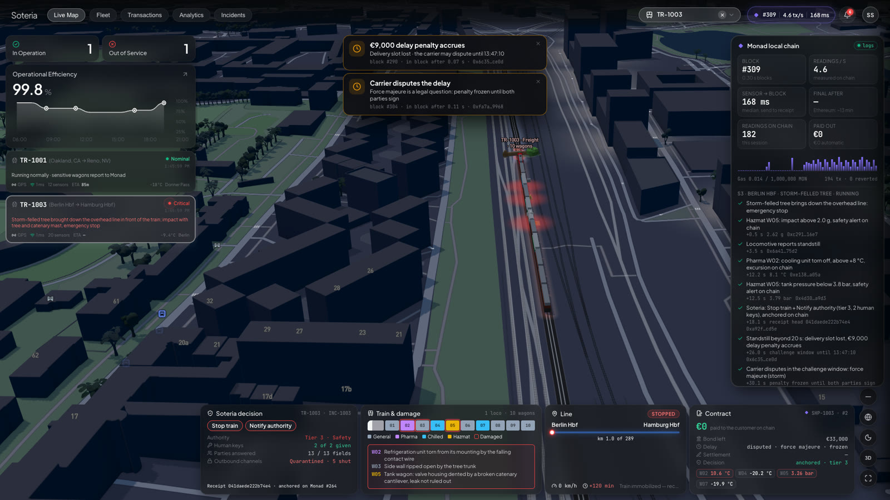

# Soteria

Live monitoring for rail freight, with automatic compensation when cargo is damaged
or late.

Today, when cargo is damaged on the rails, a dispute starts: report, assessment,
counter-assessment, and payment months later. The sensor data that could settle the
case usually sits with the carrier, which is also the liable party.

Soteria turns that around. Shipper and carrier agree on the rules at booking.
Sensors on the wagons report while the train runs, and every reading is recorded so
that no party can change it afterwards. When a rule is broken, the cargo owner is
paid automatically, within a second, without a claim form:

- **Measurable cases settle automatically.** Examples are a broken cold chain and a
  missed delivery slot.
- **Cases that need judgement go to the incident workflow.** Damage to a wagon
  without a sensor is one example. A decision is made there, two people approve it,
  and the result is anchored with a receipt.

**Before:** damage → report → assessment → dispute → paid after months.
**With Soteria:** the sensor reading is the claim.

[**Live demo**](https://soteria-monad.vercel.app/sensors.html) · [Operations console](https://soteria-monad.vercel.app) · [A real payment on the explorer](https://testnet.monadvision.com/tx/0x49103714c29da0a701ac80226bddd2f21736757810b08efbee50b215c1df5569)



## What is in this repository

| Part | Path | What it does |
|---|---|---|
| Operations console | `soteria-frontend/` | Live 3D map with each train on its real track, fleet sensors, incidents, analytics, payout history |
| Settlement contracts | `contracts/` | `SoteriaRail.sol` (bookings, excursions, delay penalties, liability pool), `SensorPayout.sol` (one small contract per monitored condition) |
| Relayer | `relayer/` | Simulated wagon devices, scenario timelines, keeper and a rate-limited RPC pool, streamed to the console over SSE |
| Assessor | `soteria/`, `agent/` | Federated assessment of damage that sensors can't settle, with a need-to-know matrix so no party learns more than it may |
| Sensor demo | `sensor-demo/` | Standalone run of `SensorPayout` on a public testnet, with a transaction dashboard |
| Case data | `data/` | Invented trains, parties, contracts and incidents, shared by every part |
| Demo film | `soteria-frontend/video.html`, `soteria-frontend/src/video/` | 45 s film, rendered frame by frame from the same map and data |

## Proof: every row is a real testnet transaction

The pharma wagon `s3/W02` on the public testnet. The contract pays the customer in
the same transaction as the reading:

| t | Reading | What the contract did | Paid to the customer |
|---|---|---|---|
| +0 s | 8.8 °C | Excursion starts, grace period 10 s | – |
| +2 … +10 s | 9.0 → 9.8 °C | Grace period: nothing paid | – |
| +13 s | 10.0 °C | Pays 3 s × 0.004 | [0.012 MON](https://testnet.monadvision.com/tx/0x84d66446c05591d8d639ddb48274d8231c682f511df736bb8c5e98d5a4f43613) |
| +14 s | 10.2 °C | Pays 1 s | [0.004 MON](https://testnet.monadvision.com/tx/0x31fef9d675798a0ad4d31e9dc1805a711d749a8814b9413b7b5889fa8d84051b) |
| +16 s | 10.4 °C | Pays 2 s | [0.008 MON](https://testnet.monadvision.com/tx/0x12d03a83c5f517a4f71caeb500e4728f050a69db3fa8286c875c343518c1df36) |
| +18 s | 5.4 °C | Pays 2 s, then back in limits: the excursion ends | [0.008 MON](https://testnet.monadvision.com/tx/0xa74fd1a7af99e75e6597f2b800f90b92cf24c369a59e408f9c00b2e4b7e300a3) |

Across those runs, 127+ transactions went through with none failed. The customer
wallet [`0x610C…C020`](https://testnet.monadvision.com/address/0x610C0DD8eA0f80e29d942a5977BAf6429E6BC020)
was paid in native MON. The full history is in
[`sensor-demo/data/tx-dashboard.html`](sensor-demo/data/tx-dashboard.html). Demo
scale: 1 MON stands for €100,000, so the pharma rate of €400/s is 0.004 MON/s.

Deployed on Monad testnet:

- **SensorPayoutFactory:** [`0x125a0db0c0ec3bd47abb8d82c53e4bc312406d28`](https://testnet.monadvision.com/address/0x125a0db0c0ec3bd47abb8d82c53e4bc312406d28)
- **SoteriaRail:** [`0x01ca38e6540091d95f68d944430aafbd827654d2`](https://testnet.monadvision.com/address/0x01ca38e6540091d95f68d944430aafbd827654d2)
- **TEUR:** [`0x097b2ec554028c91f207570c7d6dab8b70747275`](https://testnet.monadvision.com/address/0x097b2ec554028c91f207570c7d6dab8b70747275)

## How settlement works

### Sensors only where needed

| Cargo | Sensor | What it records |
|---|---|---|
| Frozen food, pharmaceuticals (reefer) | temperature | Automatic compensation for every second out of range |
| Hazardous liquid (tank) | pressure, temperature, shock | Timestamped `SafetyAlert` as proof of timely notification, no payout |
| General goods | none | nothing |
| Locomotive | speed | Standstill and arrival, which drive the delay penalty |

In the demo, 6 of 16 wagons carry sensors, plus 2 locomotives. Devices sample at
4 Hz. What gets recorded:

- **Heartbeat:** every 10 s, with the min, max and last value of the window.
- **1 Hz:** near a threshold or after an impact, for as long as the reading can
  still change money.
- **Silence:** a monitored wagon that goes silent counts as out of range.

### Settlement rules (`contracts/src/SoteriaRail.sol`)

| Event | Settlement |
|---|---|
| Temperature out of range, after a grace period | Accrues per second. Paid automatically when the excursion ends or the wagon cap is reached |
| Standstill beyond the slack, or deadline missed | The delay penalty accrues and is paid after a challenge window. The carrier can dispute it (force majeure) |
| Tank pressure drop or impact | `SafetyAlert` with a timestamp, no payout |
| Damage without a sensor, or a disputed delay | Soteria decision and receipt hash. Paid from the carrier's liability pool once both parties sign |

The carrier's bond covers only the automatic exposure. Larger claims come from a
fleet-wide pool, up to the liability cap in `data/contracts/`. Money is `tEUR`, a
demo token with no value. No place, company or goods name is recorded on the ledger.

### How the assessor decides

The assessor (`soteria/`) handles what sensors can't settle. It is a team of five
roles (intake, assessor, legal, supplier, customer) running as a federation on
[Flower](https://flower.ai). Each party keeps its own data on its own node:

- **The need-to-know matrix is data.** `data/schema/field_catalogue.json` sets which
  role sees which field at which resolution: raw, a coarse class, a traffic light, a
  threshold, a flag or nothing. See `docs/MATRIX.md`.
- **The assessor sees projections only.** It decides on traffic lights and
  thresholds, never on a party's raw values. `scripts/wire_proof.py` checks that no
  raw value crosses a role boundary.
- **Code sets the limits around the model.** A language model may propose measures.
  Code enforces the safety floor, approval tiers and two human keys. If the model is
  unreachable, the rule policy decides and the event says so.
- **Every step leaves a receipt.** Receipts are chained, so a change anywhere in
  the middle shows up.

## The ledger: Monad today, replaceable

Settlement needs a record that neither shipper nor carrier controls, and rules that
pay out by themselves from a pre-funded bond. The contracts run on
[Monad](https://monad.xyz) today. Monad is an EVM-compatible layer-1 blockchain that
executes transactions in parallel, finalises a block in about 0.6 s, and handles
around 10,000 transactions per second. I chose it for this workload for three
reasons:

- **Many small writes at once.** Each wagon writes only its own storage slot. When a
  whole corridor switches to 1 Hz during a storm, the readings run in parallel
  without conflicts.
- **Fast finality.** Money moves while the incident is still happening, not minutes
  later.
- **Low cost per reading.** A reading costs about $0.0001.

Nothing in the design depends on Monad. The contracts are plain Solidity. The
relayer sends standard EVM transactions and falls back to standard `logs` and
receipt polling when a node lacks Monad's `monadLogs` and
`eth_sendRawTransactionSync`. Moving to another EVM chain, or to a permissioned
ledger run by a group of carriers and shippers, means adding a network to
`relayer/src/config.ts` and re-tuning the gas limits.

## Run it locally

Needs Node 22+ and [Foundry](https://getfoundry.sh). The local chain uses Monad's
Foundry fork (`curl -L https://foundry.category.xyz | bash && foundryup --network monad`).

```shell
cd contracts && forge install foundry-rs/forge-std --no-git && forge test   # 32 tests
cd ../relayer && npm install
npm run chain        # terminal 1: local chain, 0.3 s blocks
npm run setup        # deploy, mint tEUR, fund the keys
npm start            # terminal 2: devices, scenarios and keeper on :8787
cd ../soteria-frontend && npm install && npm run dev   # terminal 3: console
```

To run the same demo against the public testnet instead, set up `relayer/.env`
with `MONAD_NETWORK=testnet` and run `./demo-local.sh` (relayer on :8787, console
on :5173). The sensor contracts alone run from `sensor-demo/`
(`npm i && npm run deploy && npm run demo`, see its README).

The console needs a free Mapbox token for 3D buildings and terrain (see
`soteria-frontend/README.md`). Without one it falls back to keyless satellite
imagery.

The assessor runs on Python 3.11+ with [uv](https://docs.astral.sh/uv/):

```shell
uv sync
uv run pytest
uv run python scripts/validate_data.py     # checks the case data
uv run python scripts/wire_proof.py        # proves no raw value crosses a role boundary
./scripts/federation.sh up s3              # local federation, one node per party
```

## Walkthrough

Everything runs from the ledger panel on the right of the live map. Press **D** to
hide the buttons.

1. **Go live.** Both shipments are booked and accepted. Open **Fleet**:
   - Every monitored wagon streams at 4 Hz.
   - A purple dot marks each reading that reached the ledger.
   - General-goods wagons show "No sensor".
2. **s1 · Reefer failure** (Donner Pass, 11 °C outside):
   - An impact damages the cooling unit on wagon W02.
   - The air warms past −15 °C and the device switches to 1 Hz.
   - An excursion opens and the € counter starts running.
   - Soteria decides to cool the cargo, and backup cooling starts.
   - The excursion ends and the customer is paid, final in under a second.
3. **s3 · Storm** (Berlin Hbf, storm):
   - The train makes an emergency stop. Hazmat tank W05 raises a shock alert, then
     a pressure alert.
   - Pharma unit W02 is torn off. It warms past +8 °C and accrues €400/s, up to its
     €12,000 cap.
   - The standstill costs the delivery slot, and a €9,000 delay penalty accrues.
   - The carrier disputes it (force majeure).
   - Soteria assesses the damage to W03, which has no sensor. The customer signs,
     €24,000 is paid from the pool and the delay penalty is waived.
4. **Storm burst:** 20 wagons on the corridor switch to 1 Hz at once, about 240
   readings in 12 s. Readings per second spike while latency stays flat.

## Deploy

The console is static (Vercel, root directory `soteria-frontend`). The relayer is a
long-running process (Railway, built from `relayer/Dockerfile` via `railway.json`).

1. **Locally:** create `relayer/.env` with `MONAD_NETWORK=mainnet` (or `testnet`)
   and `FUNDER_PRIVATE_KEY=0x…`, and never commit it. Then run `npm run setup` in
   `relayer/`. This deploys the contracts, funds the keys and writes
   `relayer/.keys/<network>.json` and `data/monad/deployments.json`. Commit
   `deployments.json`, which holds addresses only.
2. **Railway variables:**
   - `MONAD_NETWORK`
   - `RELAYER_KEYS`: the content of `relayer/.keys/<network>.json` (secret)
   - `CONTROL_TOKEN`: any long random string

   Generate a public domain under Settings → Networking.
3. **Vercel:** set `VITE_RELAYER_URL=https://<railway domain>` and redeploy.
4. **Operator:** open the console once as `https://<vercel domain>/?control=<CONTROL_TOKEN>`.
   Everyone else can watch but not spend.
5. Run `npm run sweep` afterwards to return the funds parked on the keys.

## Cost and safeguards

Gas was measured on a local node. Monad charges the gas limit, so every path has its
own tight limit:

| Path | Gas used | Limit |
|---|---|---|
| Reefer reading in range | 52k | 58k |
| Reefer reading, excursion open | 61k | 67k |
| Reefer reading, excursion settles | 138k | 152k |
| Tank or locomotive reading | 60k | 67k |

At the minimum base fee, a reading costs about 0.006 MON (about $0.0001). One full
walkthrough (go live, s1, s3, storm and a few minutes of heartbeats) costs about
5–6 MON. About 1.4 MON of that is the storm burst.

- **Spending cap per relayer run:** `MAX_MON_SPEND` (default 16 on mainnet). The
  relayer stops sending when it is reached.
- **Auto-stop:** a live run closes itself after 15 minutes without a click.
- **Gas calibration:** at go live, free `eth_estimateGas` calls scale the limits to
  current network pricing. A reading that still runs out of gas gets a 30% higher
  limit.
- **Simulation first:** every transaction other than a reading is simulated before
  it is sent, because a revert still pays its gas limit.

## Limits

- **Sensors are simulated.** Temperatures, pressures and places are realistic. How
  fast a failed unit warms, and the grace, slack and challenge windows, are
  compressed for the demo.
- **All data is invented.** No real railway data, people or companies.
- **Public RPCs are rate limited** (15–30 requests/s each). The relayer spreads the
  load over several endpoints. During the storm burst the RPCs are the bottleneck,
  not the chain.
- **Device keys are agreed at booking.** Hardware attestation is out of scope. A
  device that goes silent is covered by the gap rule.
- **Liability law still applies.** Automatic settlement covers what both parties
  agreed to in advance. Statutory regimes such as CIM for international rail
  freight, and their liability caps, sit above it.

## Layout

| Path | What |
|---|---|
| `contracts/` | `SoteriaRail.sol`, `SensorPayout.sol`, `TEUR.sol` and 32 Foundry tests |
| `relayer/src/` | Simulated devices (`physics.ts`), scenario timelines and keeper (`scenarios.ts`), RPC pool with budget (`chain.ts`), SSE server (`server.ts`), network table (`config.ts`) |
| `soteria-frontend/src/chain/` | Live store: relayer stream and a direct WebSocket to the node |
| `soteria-frontend/src/components/` | Map, fleet, incidents, analytics and ledger panels |
| `soteria/` | Assessor: roles, need-to-know matrix, policy, typed envelopes, receipts |
| `scripts/` | Data validation, wire proof, run recording, benchmark, local federation |
| `data/monad/demo.json` | Which wagons are monitored, thresholds, rates and demo timings, shared by relayer and console |
| `docs/` | Need-to-know matrix and event contract |

## License

Apache 2.0, see `LICENSE`.
